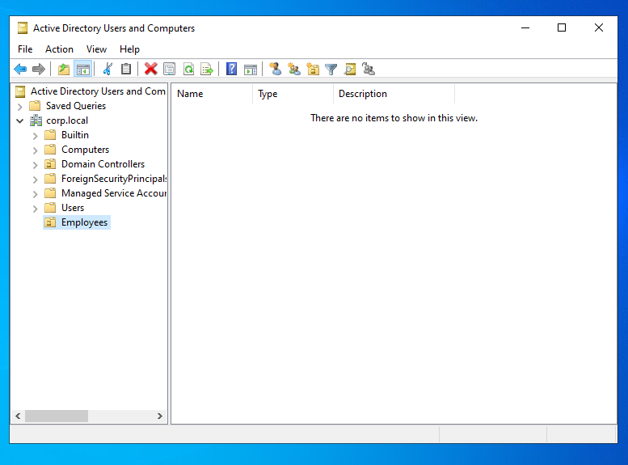
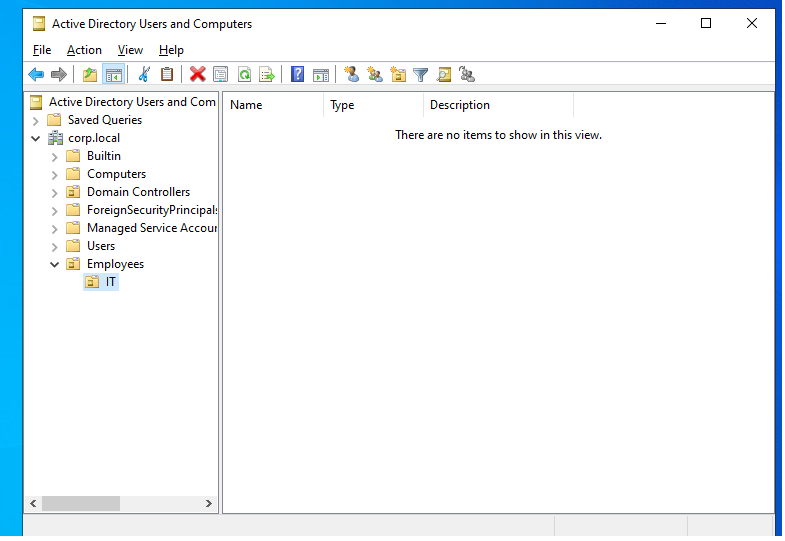
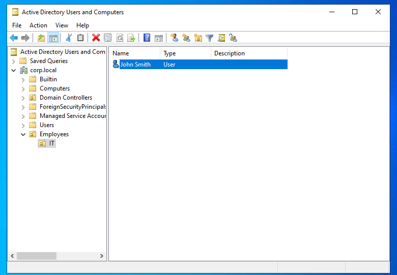
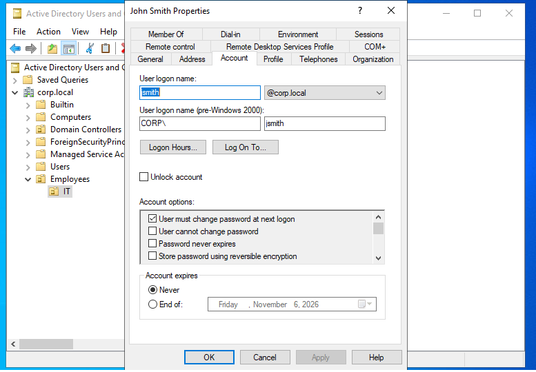
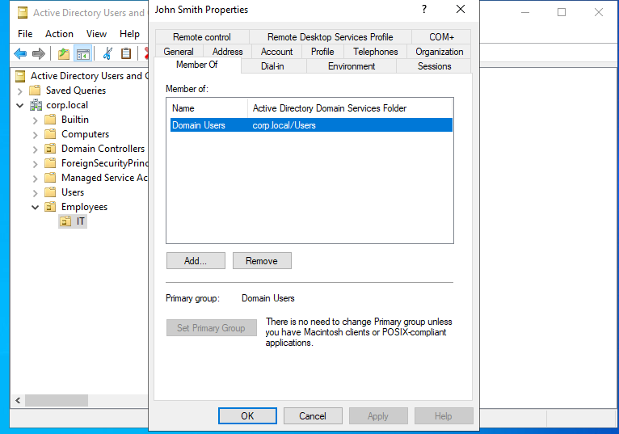
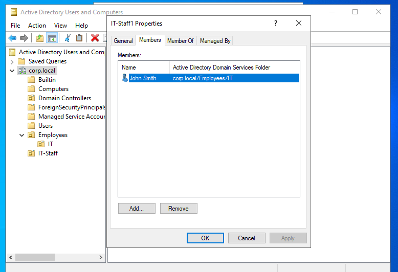
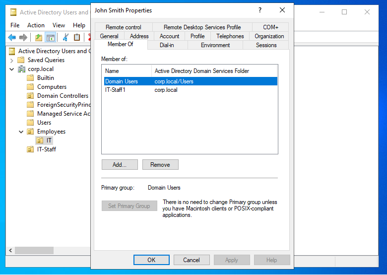
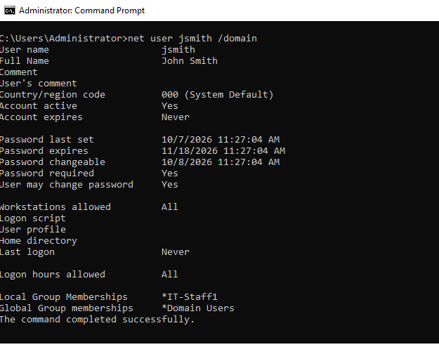
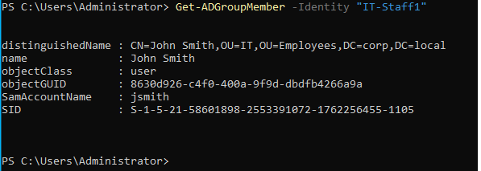

# Lab 01 — Active Directory User Account Management

## Scenario

**Ticket #001:** A new employee, John Smith, is joining the IT department. Create his domain account and add him to the appropriate security group.

## Objectives

- Create and organize Organizational Units (OUs).
- Create a domain user account in Active Directory.
- Configure account settings.
- Create a security group and assign group membership.
- Verify the account and group membership.

## Environment

- **Operating System:** Windows Server 2022
- **Domain:** `corp.local`
- **Tools:** Active Directory Users and Computers (ADUC), PowerShell

## Steps Performed

1. Created an `Employees` OU under the `corp.local` domain.
2. Created an `IT` OU inside `Employees`.
3. Created the domain user `jsmith` for John Smith in `Employees/IT`.
4. Configured the account to require a password change at the next logon.
5. Reviewed the user's Account and Member Of properties.
6. Created the `IT-Staff1` security group.
7. Added John Smith to `IT-Staff1`.
8. Verified the group membership using PowerShell.

## Screenshots

### 1. Employees Organizational Unit

### 2. IT Organizational Unit

### 3. John Smith's User Account

### 4. Account Properties

### 5. User Group Membership Settings

### 6. Security Group

### 7. John Smith's IT Group Membership

### 8. Group Membership Verification

### 9. PowerShell Verification

## Results

- Created John Smith's domain account in `corp.local`.
- Organized the account under `Employees/IT`.
- Added the account to the `IT-Staff1` security group.
- Verified group membership using PowerShell.

## What I Learned

- How Organizational Units help organize domain accounts.
- How to create and configure Active Directory user accounts.
- How security groups organize users for access and permissions.
- How to verify group membership using PowerShell.
- How to document a help desk onboarding task.

## Skills Practiced

Active Directory, user account management, Organizational Units, security groups, PowerShell, account configuration, and technical documentation.
