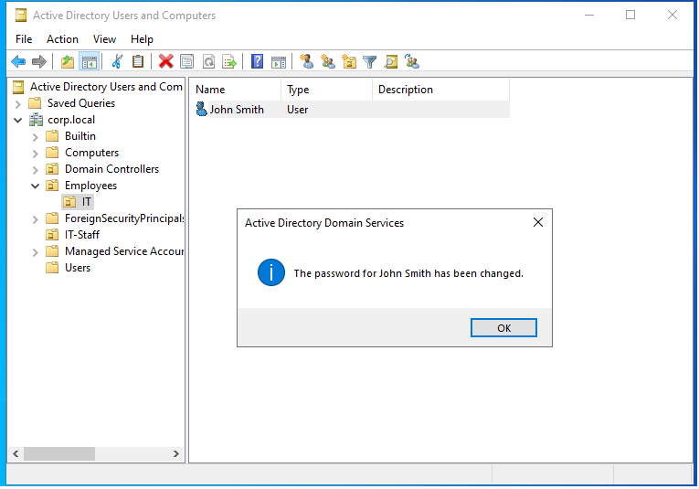
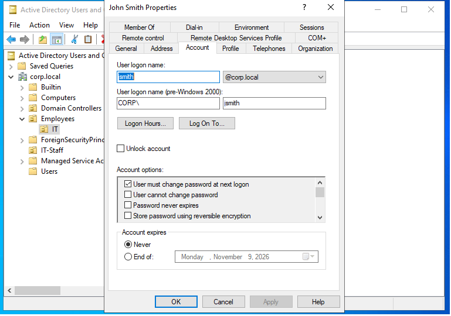
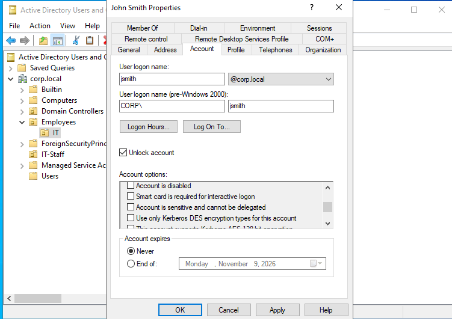
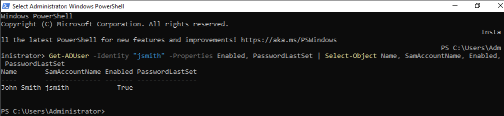

# Lab 02 — Active Directory Password Reset

## Scenario

**Ticket #002:** John Smith (`jsmith`) reports that he forgot his password and cannot sign in to his domain account. As the help desk technician, I need to reset his password and verify his account settings.

## Objectives

- Reset a domain user's password.
- Require a password change at the next logon.
- Verify account status and password information.
- Document the resolution of a help desk ticket.

## Environment

- **Operating System:** Windows Server 2022
- **Domain:** `corp.local`
- **Tools:** Active Directory Users and Computers (ADUC), PowerShell

## Steps Performed

1. Located John Smith's account in Active Directory Users and Computers.
2. Reset the account password using the Reset Password option.
3. Selected the option requiring the user to change their password at the next logon, if available.
4. Reviewed the Account tab to check the account settings.
5. Verified the account status and password timestamp using PowerShell.

## Screenshots

### 1. Password Reset Confirmation

### 2. Account Settings

### 3. Account Enabled

### 4. PowerShell Verification

## Results

The password reset was completed successfully. The account settings were reviewed, and PowerShell was used to verify the user's account status and password information.

## What I Learned

- How to reset a domain user's password in Active Directory.
- Why help desk technicians may require a password change at the next logon.
- How to review account settings in ADUC.
- How to use PowerShell to verify account status and password information.
- How to document a password-reset ticket.

## Skills Practiced

Active Directory, password resets, account management, PowerShell, account verification, and help desk documentation.

