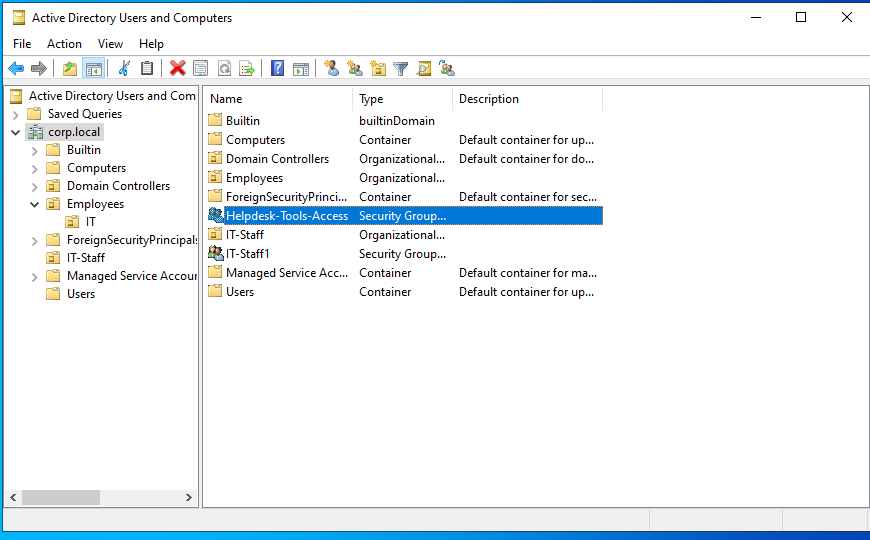
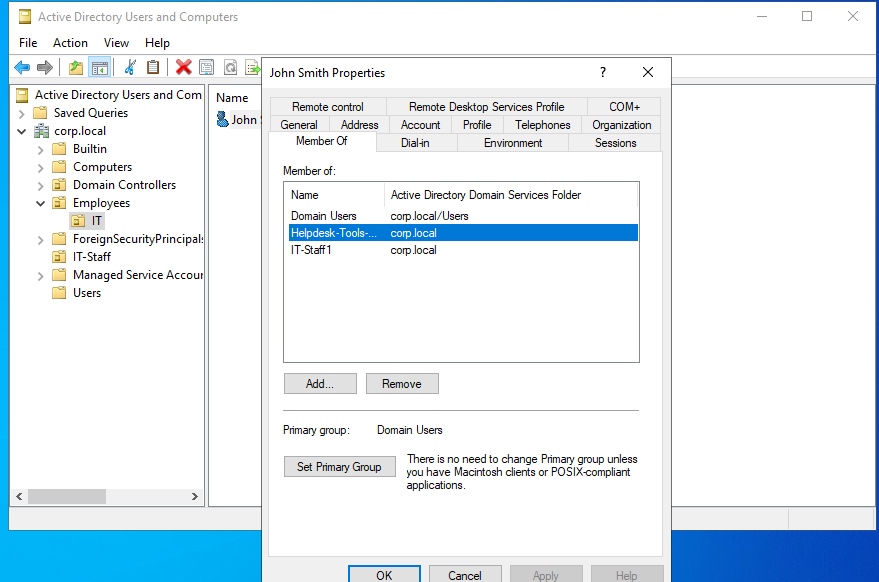
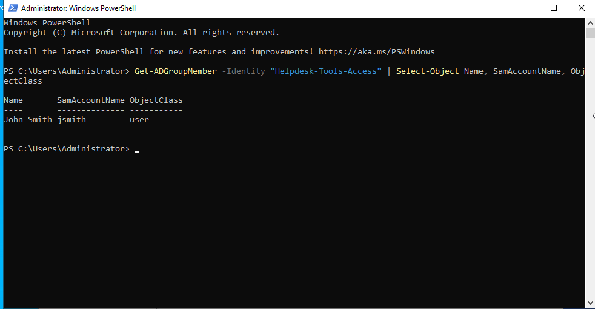

# Lab 03 — Active Directory Security Group Management

## Scenario

**Ticket #003:** A manager requests that John Smith (`jsmith`) be added to a security group for help desk tools. As the help desk technician, I need to create the group, add the user, and verify group membership.

## Objectives

- Create an Active Directory security group.
- Add an existing domain user to the group.
- Verify group membership using PowerShell.
- Document the completed help desk task.

## Environment

- **Operating System:** Windows Server 2022
- **Domain:** `corp.local`
- **Tools:** Active Directory Users and Computers (ADUC), PowerShell

## Steps Performed

1. Created the `Helpdesk-Tools-Access` security group in Active Directory.
2. Configured the group scope as Global.
3. Located John Smith's domain account.
4. Added John Smith to `Helpdesk-Tools-Access` through the account's **Member Of** tab.
5. Used PowerShell to verify the group's membership.

## Screenshots

### 1. Security Group Created

### 2. Group Membership

### 3. PowerShell Verification

## Results

The `Helpdesk-Tools-Access` security group was created successfully. John Smith was added to the group, and PowerShell confirmed his membership.

## What I Learned

- How to create a security group in Active Directory.
- The difference between group scope and group type.
- How to add a user to a group through the user's properties.
- How to verify group membership using PowerShell.
- How to document a help desk request.

## Skills Practiced

Active Directory, security group management, user administration, PowerShell, verification, and help desk documentation.
