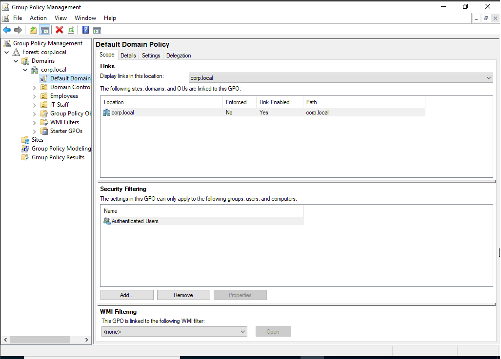
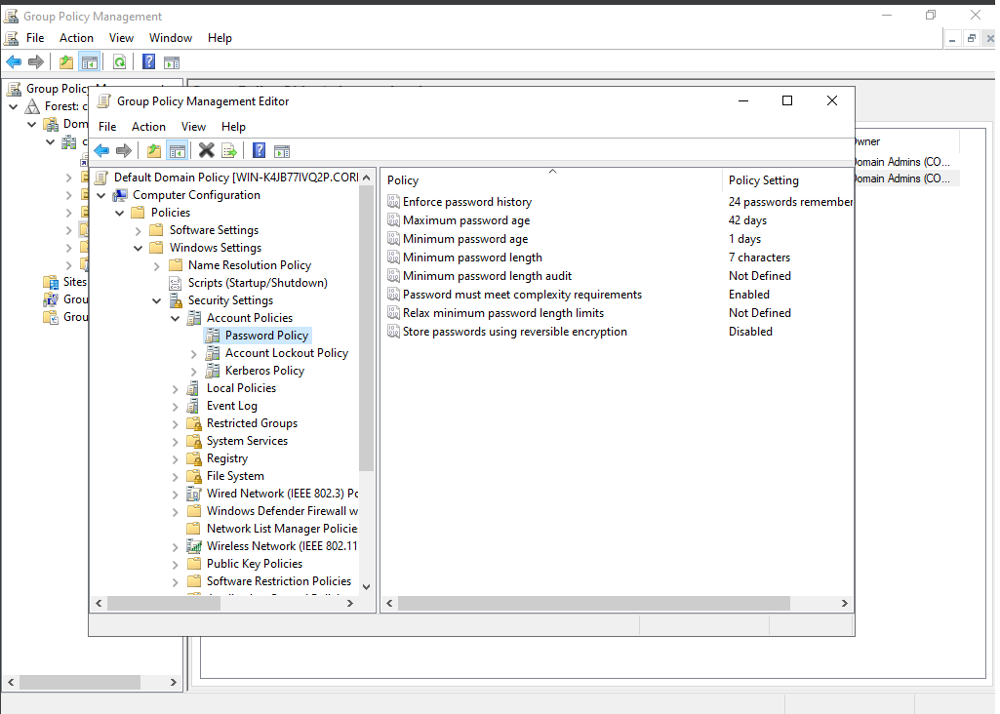
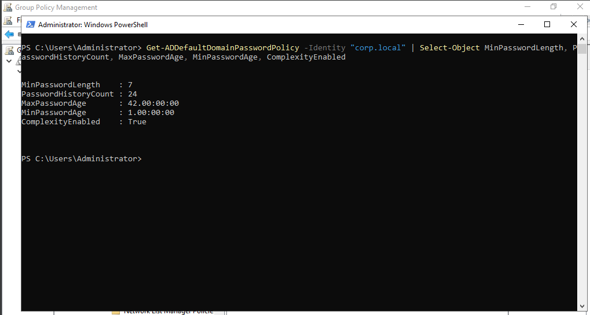
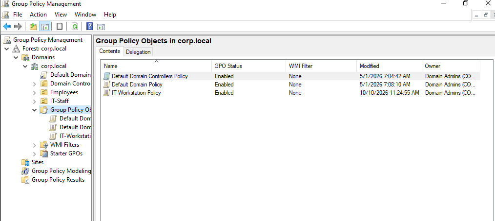
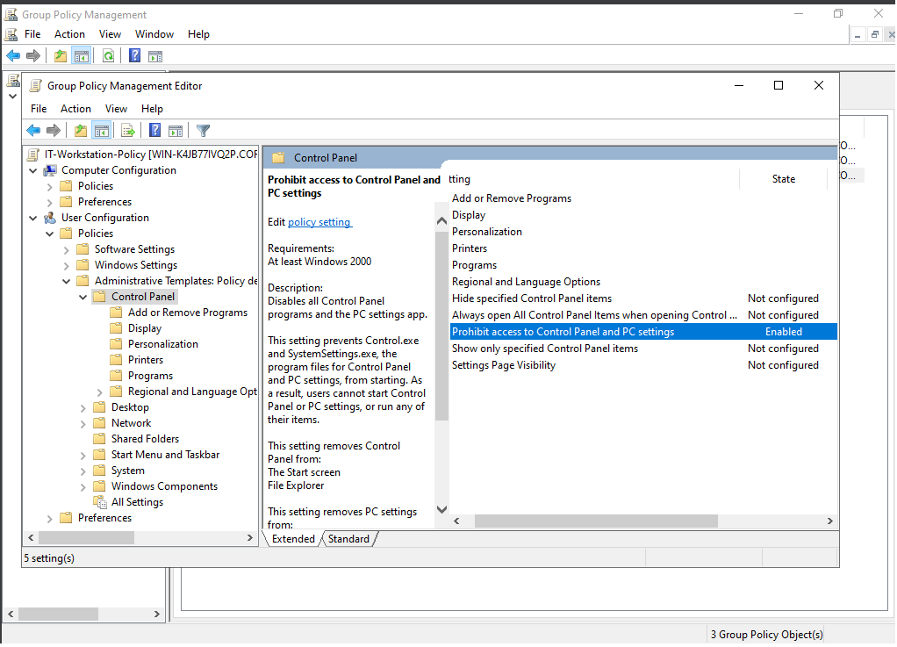
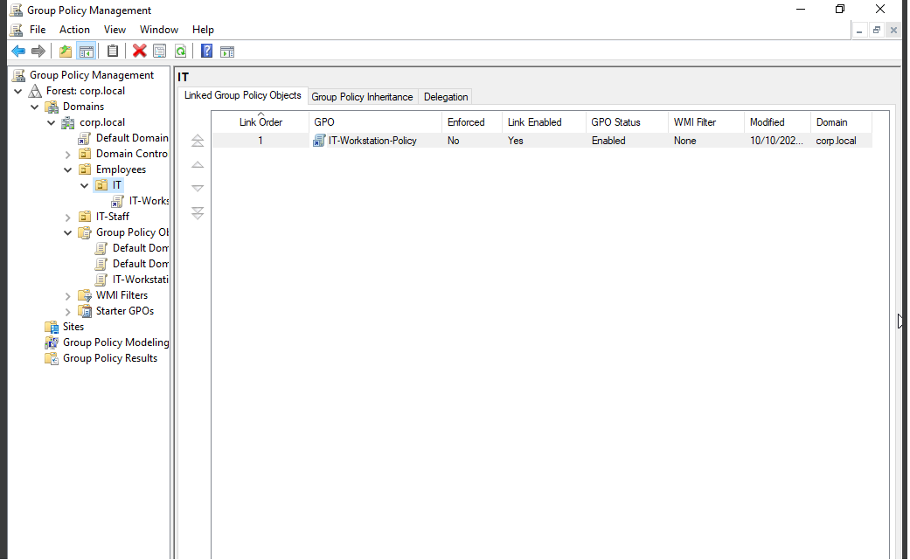
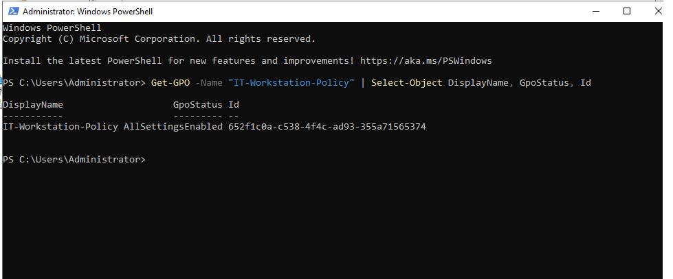
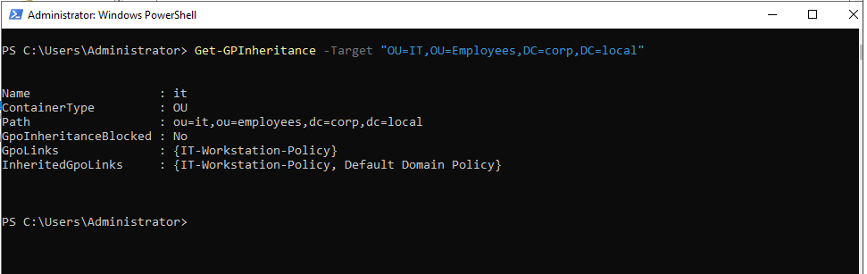

# Lab 04 — Group Policy Management

## Scenario

**Ticket #004:** An IT supervisor asks me to create a Group Policy Object (GPO), configure a workstation restriction, link the policy to the IT organizational unit (OU), and verify the configuration.

## Objectives

- Inspect the existing domain password policy.
- Create a separate Group Policy Object.
- Configure a user policy setting.
- Link the GPO to an organizational unit.
- Verify the GPO and its link using PowerShell.

## Environment

- **Operating System:** Windows Server 2022
- **Domain:** `corp.local`
- **Tools:** Group Policy Management, Group Policy Management Editor, PowerShell

## Steps Performed

1. Opened Group Policy Management and located the Default Domain Policy.
2. Inspected the existing password policy settings without modifying them.
3. Used PowerShell to retrieve the current domain password policy.
4. Created a separate GPO named `IT-Workstation-Policy`.
5. Enabled **Prohibit access to Control Panel and PC settings** in the GPO.
6. Linked the GPO to the `IT` OU under `Employees`.
7. Verified the GPO details using `Get-GPO`.
8. Verified the OU's Group Policy links using `Get-GPInheritance`.

## Screenshots

### 1. Default Domain Policy

### 2. Existing Password Policy Settings

### 3. Password Policy PowerShell Verification

### 4. Test GPO Created

### 5. Control Panel Restriction Configured

### 6. GPO Linked to the IT OU

### 7. GPO PowerShell Verification

### 8. GPO Link PowerShell Verification

## Results

Created and configured `IT-Workstation-Policy`, enabled the Control Panel restriction, and linked the GPO to the `IT` OU. PowerShell confirmed the GPO details and its inheritance configuration.

The policy was configured and linked, but its effect on a user's session was not tested as part of this lab.

## What I Learned

- How to inspect a domain password policy.
- How to create and edit a GPO.
- How to configure a user policy setting.
- How to link a GPO to an organizational unit.
- How to verify GPO information and inheritance with PowerShell.
- Why configuration and successful application are separate things to verify.

## Skills Practiced

Group Policy management, Active Directory organizational units, Windows administration, PowerShell verification, configuration management, and technical documentation.
