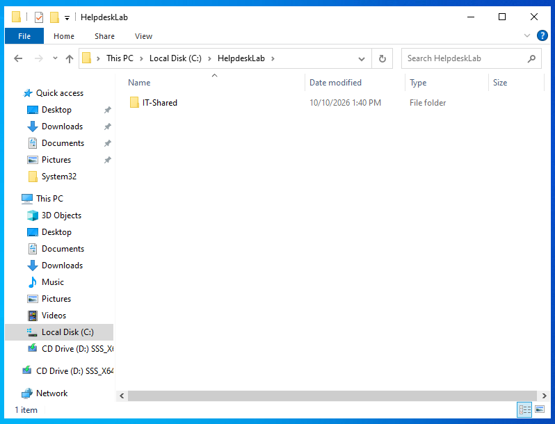
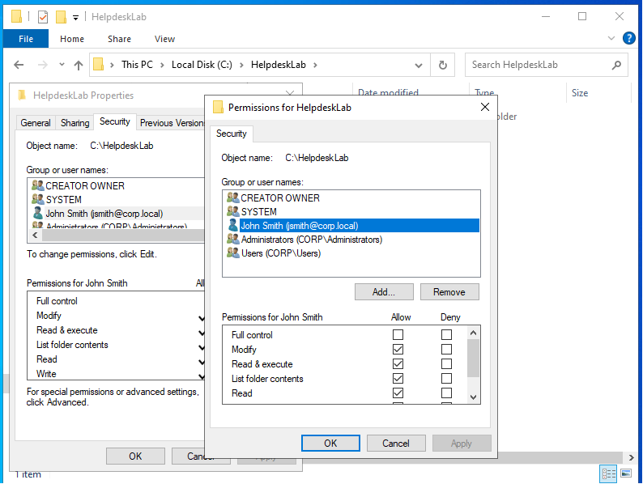
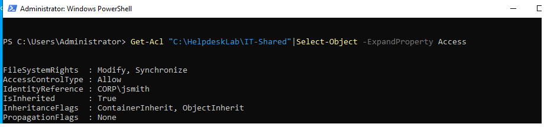

# Lab 05 — Windows File and Folder Permissions

## Scenario

**Ticket #005:** An employee needs access to a department folder. As the help desk technician, I need to grant the employee the appropriate permissions and verify the configuration.

## Objectives

- Create a test folder.
- Assign permissions to a domain user.
- Understand the Modify permission.
- Verify folder permissions using PowerShell.
- Document the completed help desk task.

## Environment

- **Operating System:** Windows Server 2022
- **Domain:** `corp.local`
- **Tools:** File Explorer, folder Properties, PowerShell

## Steps Performed

1. Created the test directory `C:\HelpdeskLab\IT-Shared`.
2. Opened the folder's Properties and navigated to the Security tab.
3. Added the domain user `corp\jsmith` to the folder's permissions.
4. Allowed the Modify permission for John Smith.
5. Used PowerShell's `Get-Acl` command to inspect the folder's access control entries.
6. Reviewed the permission output to verify the user's access rules.

## Screenshots

### 1. Test Folder Created

### 2. John Smith's Folder Permissions

### 3. PowerShell Permission Verification

## Results

Created a test folder and configured permissions allowing John Smith to modify its contents. Used PowerShell to inspect the folder's access control entries and review the assigned permissions.

## What I Learned

- How to manage Windows file and folder permissions.
- How to add a domain user to a folder's access list.
- How the Modify permission differs from read-only access.
- How to use `Get-Acl` to inspect access control entries.
- Why verifying permissions is important when troubleshooting file-access tickets.

## Skills Practiced

Windows administration, NTFS permissions, Active Directory user management, PowerShell, access control, and help desk documentation.
